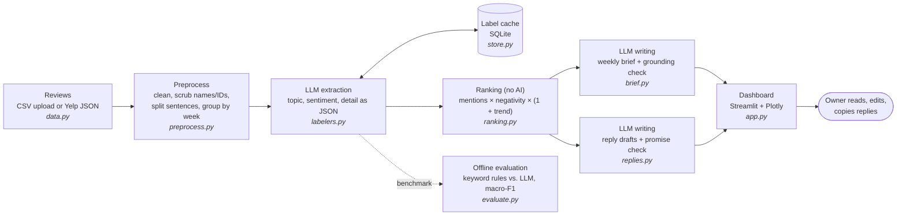

# ReviewPulse

AI review insights for independent restaurants. ReviewPulse turns a restaurant's reviews into a weekly brief of the three problems hurting its rating most, with trends and quoted evidence, and drafts replies the owner edits and approves.

CECS 451 Term Project, Team 5: Christian Vanegas, Nathan Sarkozy, Nguyen Nguyen, Nathan Fender

> **Status (Phase 2, Nov 20, 2026):** working MVP, run live with Claude Opus 5.5. The full flow (CSV → sentences → labels → ranked problems → brief → reply drafts) runs in a Streamlit dashboard and from the command line, with Claude Opus 5.5 or a fully offline keyword fallback. See [Completed vs. planned](#completed-vs-planned).

## Architecture



Two steps use the LLM (sentence labeling and writing); everything between them is plain, inspectable code. If no API key is set, or a call fails or is refused, each LLM step falls back automatically: keyword rules label sentences, and template text writes the brief and replies. The app therefore always runs.

## Setup

Requirements: Python 3.10+. An Anthropic API key is optional (needed only for the Claude labeler and generated text).

```bash
git clone https://github.com/CECS447-120934/ReviewPulse.git
cd ReviewPulse
python -m venv .venv
# Windows: .venv\Scripts\activate    macOS/Linux: source .venv/bin/activate
pip install -r requirements.txt
cp .env.example .env   # then put your ANTHROPIC_API_KEY in .env (never commit it)
```

Configuration (environment variables or `.env`):

| Variable | Default | Purpose |
| --- | --- | --- |
| `ANTHROPIC_API_KEY` | unset | Enables Claude. Unset means offline mode. |
| `REVIEWPULSE_MODEL` | `claude-opus-5-5` | Model used for labeling, brief and replies. |

## Data

- **Sample (included):** `data/sample_reviews.csv` has 38 synthetic reviews of a fictional Long Beach Italian restaurant over 6 weeks (Sep 28 to Nov 8, 2026). It includes a planted problem: wait-time complaints grow over the last four weeks. It also contains fake names, a phone number, an email and a URL, to test scrubbing.
- **Gold labels (included):** `data/gold/sample_gold.csv` has the 92 preprocessed sample sentences, each with one topic and sentiment. These are a **single AI-assisted draft** (from a Claude model, the same family as the labeler under test). They still need the human second-labeler pass and Cohen's kappa planned in Phase 1, so treat scores against them as preliminary. Human labeling follows [`docs/labeling_guideline.md`](docs/labeling_guideline.md): label the main thing the sentence judges; slowness and waiting are `wait_time`, and staff behavior is `service`.
- **Human labeling (in progress):** `data/gold/annotations/sample_blind.csv` is the same 92 sentences with the labels removed. Two team members fill in copies on their own; `agreement.py` measures Cohen's kappa, lists disagreements and merges the resolved labels into a human gold set.
- **Yelp Open Dataset (not included):** its terms restrict redistribution. Download it from https://business.yelp.com/data/resources/open-dataset/ and put the JSON files in `data/raw/` (git-ignored). Use `data.list_restaurants("data/raw", city="Philadelphia")` to pick a `business_id`.
- **Your own CSV:** any file with a text column (`text`, `review`, `comment`, `body`...) and a date column (`date`, `created_at`, `review_date`...). A rating column (`stars`, `rating`...) is optional.

## Run the prototype

```bash
# Dashboard: choose the sample or upload a CSV, then press Analyze
streamlit run app.py

# Command line: prints the top problems and the brief, writes outputs/
python pipeline.py data/sample_reviews.csv            # Claude if a key is set
python pipeline.py data/sample_reviews.csv --offline  # keyword baseline, no API calls
python pipeline.py data/raw --business-id <id> --limit 400

# Evaluation against the gold labels, and the unit tests
python evaluate.py              # keyword baseline, plus Claude if a key is set
python -m pytest tests/ -q      # 49 tests, no network needed (the Claude client is faked)

# Inter-annotator agreement for human gold labels (see docs/labeling_guideline.md)
python agreement.py compare data/gold/annotations/sample_A.csv data/gold/annotations/sample_B.csv
```

## Reproduce a sample result

```bash
python pipeline.py data/sample_reviews.csv --offline --out outputs
python evaluate.py --offline
```

The expected output, kept in [`docs/sample_output/`](docs/sample_output/), is deterministic:

```
38 reviews -> 92 sentences | labeler: keyword-rules | brief: template
Top problems:
  1. wait_time    score  21.75  negative 5 (prev 0)  trend +2.0
  2. food         score    6.5  negative 2 (prev 1)  trend +1.0
  3. service      score    5.0  negative 1 (prev 0)  trend +1.0

      labeler  n  topic_macro_f1  sentiment_macro_f1  joint_accuracy  failed_batches  wait_time_in_top3
keyword-rules 92           0.789               0.464           0.457               0               True
```

The planted wait-time problem ranks first, and each problem links to quoted sentences ([`brief.md`](docs/sample_output/brief.md), [`problems.json`](docs/sample_output/problems.json)). The keyword baseline finds topics reasonably well but gets sentiment wrong more than half the time ([`eval_errors.csv`](docs/sample_output/eval_errors.csv)). It misses implied topics ("The tiramisu was perfect." → `none`) and mixed sentences ("Food was good but a bit pricey." → `neutral`). These are the cases the LLM labeler is meant to fix.

### With Claude (needs an API key; outputs vary slightly between runs)

```bash
python evaluate.py
python pipeline.py data/sample_reviews.csv --out docs/sample_output_llm
```

Our run on Nov 20, 2026, kept in [`docs/sample_output_llm/`](docs/sample_output_llm/):

```
            labeler  n  topic_macro_f1  sentiment_macro_f1  joint_accuracy  sec_per_100  usd_per_100  wait_time_in_top3
      keyword-rules 92           0.789               0.464           0.457         0.00       0.0000               True
llm:claude-opus-5-5 92           0.971               0.974           0.957        41.59       0.0949               True

Top problems:
  1. service      score   33.0  negative 11 (prev 0)  trend +2.0
  2. wait_time    score   33.0  negative 11 (prev 3)  trend +2.0
  3. food         score  15.75  negative 5 (prev 1)  trend +2.0
```

Claude makes 4 errors out of 92, mostly "slow service" sentences labeled `service` instead of `wait_time`, and inconsistently across batches ([`eval_errors.csv`](docs/sample_output_llm/eval_errors.csv)). Service and wait time tie because both trends hit the +2 cap. The generated [`brief.md`](docs/sample_output_llm/brief.md) quotes only real sentences; the grounding check found nothing invented. The scores are against AI-drafted gold labels (see [Data](#data)), so they are preliminary. Note that `pipeline.py` reuses labels cached by `evaluate.py`, so its reported cost covers only the brief.

## Main files

| File | What it does |
| --- | --- |
| `app.py` | Streamlit dashboard: upload, KPIs, weekly trend chart, top-3 problem cards with evidence, brief, reply editor. |
| `pipeline.py` | `analyze()` runs load → preprocess → label → rank. The CLI also writes the brief and output files. |
| `data.py` | Loads Yelp JSON (streamed, filtered by business) or any CSV with flexible headers into one table. |
| `preprocess.py` | Cleans text; replaces names, phones, emails, URLs and IDs with placeholders; splits into sentences; adds the week. |
| `labelers.py` | `LLMLabeler` (Claude, batched, cached, falls back on errors) and `KeywordLabeler` (rule baseline). |
| `llm.py` | The single place that calls the Claude API: key handling, text extraction, refusals, token and cost tally. |
| `store.py` | SQLite cache so each sentence is labeled by the LLM only once (`data/labels.sqlite`, git-ignored). |
| `ranking.py` | Problem score, weekly counts, evidence selection, window summary. No AI. |
| `brief.py` | Weekly brief from the ranked problems (LLM or template), plus `check_grounding()`. |
| `replies.py` | Reply drafts (LLM or template), plus `promise_check()` for refunds, freebies and similar. |
| `evaluate.py` | Macro-F1 for topic and sentiment, joint accuracy, time and cost per 100 sentences, top-3 check, error file. |
| `agreement.py` | Human gold labels: blank labeling sheets, Cohen's kappa between two labelers, disagreement list, merge into a final gold set. |
| `schema.py` | Topic and sentiment vocabularies shared by every module. |
| `tests/` | `test_preprocess.py` (loading, scrubbing, splitting), `test_pipeline.py` (labelers, cache, ranking, brief, replies) and `test_agreement.py` (kappa, compare, merge). |

## LLM prompts and API workflow

All calls go through `llm.complete()`: Claude Opus 5.5 via `client.beta.messages.create` with server-side refusal fallback (`fallbacks="default"`) and an `effort` level per task. Claude Opus 5.5 always thinks, so the reply can begin with a thinking block. `complete()` returns only the text blocks, raises `LLMRefusal` on `stop_reason == "refusal"`, and adds token usage to a running tally for cost reporting.

**1. Sentence labeling** (`labelers.py`, `SYSTEM_PROMPT`, effort `low`)
- Input: a JSON list of up to 25 numbered, already scrubbed sentences: `Input: [{"i":1,"s":"Sat 45 minutes before anyone came over."}, ...]`
- Prompt: the allowed labels, rules for negation and implied topics, and one few-shot example.
- Output: `[{"i":1,"topic":"wait_time","sentiment":"negative","detail":"45-minute wait"}, ...]`
- Our code: `parse_llm_json` tolerates text around the array and maps unknown topics or sentiments to `none`/`neutral`. Each label is cached by (model, sentence hash). If a batch errors or is refused, that batch gets keyword labels, which are not cached.

**2. Weekly brief** (`brief.py`, `BRIEF_SYSTEM`, effort `medium`)
- Input: only the window summary and the ranked problems (counts, trend, evidence sentences) as JSON. Claude never sees raw reviews here.
- Output: under 220 words of Markdown, one numbered item per problem, with a quote copied exactly and one suggested action.
- Our code: `check_grounding()` checks that every quoted string appears in the evidence. The dashboard warns the owner about any quote it can't find.

**3. Reply drafts** (`replies.py`, `REPLY_SYSTEM`, effort `low`)
- Input: one review and its star rating. Output: a 2–4 sentence reply in the owner's voice.
- Rules: refer to what the reviewer said; no refunds, free items or discounts; no invented facts.
- Our code: `promise_check()` flags words like "refund" or "free" in the edited reply. Replies are only drafts; nothing is posted.

**The team's own contribution** beyond the API call: data loading for Yelp and arbitrary CSVs; PII scrubbing and sentence splitting; batching, caching and fallback; the ranking formula and evidence selection; grounding and promise checks; the keyword baseline; the evaluation harness and gold labels; and the dashboard.

**Cost:** at $4 / $20 per million input/output tokens, the CLI and dashboard report actual tokens and estimated dollars for each run. Measured on the sample: **$0.095 per 100 sentences** for labeling (41.6 s per 100) and about $0.016 per brief. A restaurant with 200 reviews a month (about 480 sentences) plus four weekly briefs costs **about $0.52 per month**, under the Phase 1 estimate of $1.

## Completed vs. planned

| Feature | Status |
| --- | --- |
| CSV and Yelp loading, flexible headers | Done (`data.py`) |
| Cleaning, PII scrubbing, sentence split, weekly grouping | Done (`preprocess.py`, 24 tests) |
| Claude sentence labeling (batched, cached, fallback) | Done (`labelers.py`). Live run on Nov 20, 2026 |
| Keyword baseline | Done |
| Problem ranking with trend and evidence | Done (`ranking.py`) |
| Weekly brief, LLM or template, with grounding check | Done (`brief.py`) |
| Reply drafts with promise check | Done (`replies.py`) |
| Streamlit dashboard, end to end | Done (`app.py`) |
| Evaluation harness (macro-F1, joint accuracy, cost, top-3 check) | Done (`evaluate.py`) |
| Keyword baseline results on the sample gold set | Done (table above) |
| Claude results on the draft gold set; cost per 100 sentences | Done (preliminary; see [Reproduce](#with-claude-needs-an-api-key-outputs-vary-slightly-between-runs)) |
| Second labeler and Cohen's kappa for the gold set | In progress: tooling and guideline done (`agreement.py`, `docs/labeling_guideline.md`); labeling underway |
| ~300 hand-labeled Yelp sentences | Planned (Phase 3) |
| SemEval-2014 restaurant benchmark | Planned (Phase 3) |
| Pre-trained DeBERTa-v3 ABSA baseline | Planned (Phase 3) |
| Blind 1–5 rating of LLM replies vs. template replies | Planned (Phase 3) |
| Live platform connections, auto-posting, multi-location, billing | Out of scope (see Phase 1) |

## Known limitations

- **One label per sentence.** "Food was good but a bit pricey" is about two topics; we keep only the main one, so the second complaint is lost.
- **The sample is small and synthetic.** With 38 reviews, the "previous window" covers only 2 weeks, so trends are large and noisy. Real restaurants need more history.
- **Gold labels are an AI-assisted draft.** They come from a Claude model, the same family as the labeler, and the keyword rules were written knowing the same kind of sentences. Both sets of scores are optimistic until humans re-label (Phase 3).
- **Borderline topics are inconsistent.** "Slow service" goes to `service` in some batches and `wait_time` in others.
- **The trend cap can tie scores.** Service and wait time tie at +2 on the sample.
- **The trend clip [-0.5, 2] and sentiment weights are hand-picked**, not fitted to rating outcomes. `avg_stars_when_negative` is shown as an impact hint but is not used in the score.
- **Name scrubbing is regex-based.** It catches common patterns ("our server Jessica", "ask for Mike") but not every name.
- **The grounding check covers quotes only.** It does not verify numbers or suggestions in the LLM brief.
- **Fake or incentivized reviews are not filtered** (planned outlier filter).
- **English only.**
